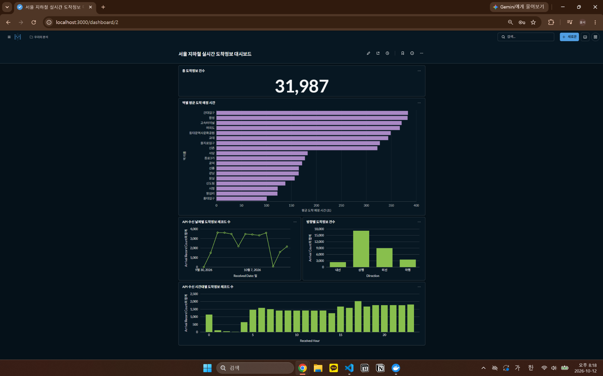
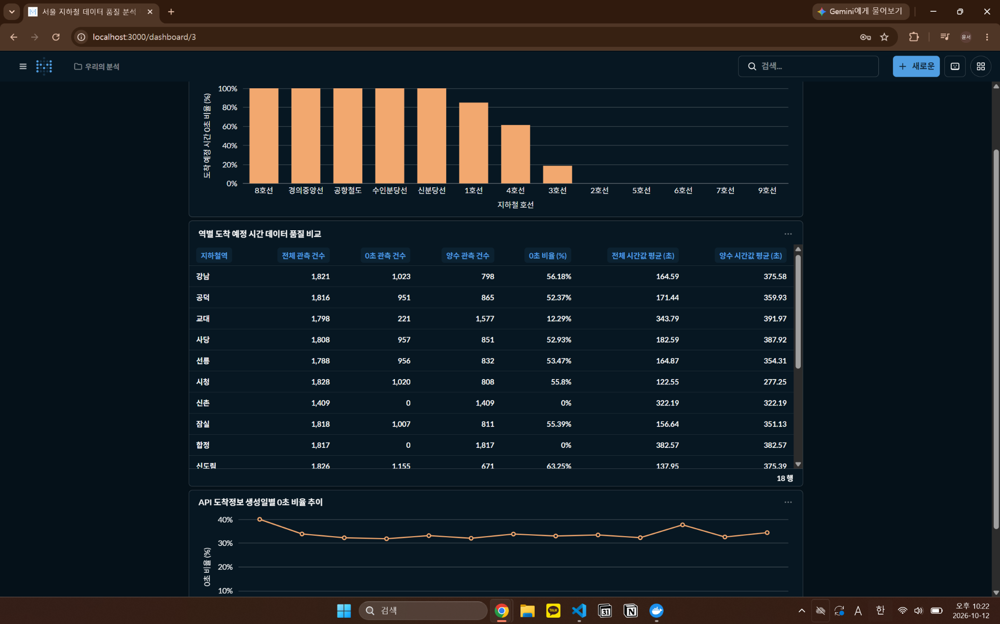
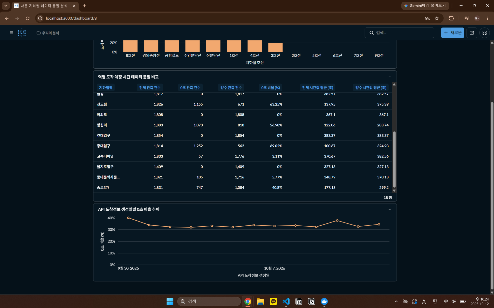

# 서울 지하철 실시간 도착정보 데이터 파이프라인 및 BI 대시보드

서울시 지하철 실시간 도착정보 API를 활용해 데이터를 수집하고,\
PostgreSQL 적재, dbt 데이터 마트 구축, Apache Airflow 자동화와 Metabase BI 대시보드까지 구현한 개인 프로젝트입니다.

데이터를 수집하는 데서 끝내지 않고 원본 보존, 전처리, 배치 적재, SQL 집계, 데이터 품질 검증, BI 시각화까지 하나의 흐름으로 연결했습니다.

---

## 1. 프로젝트 개요

서울시 지하철 도착정보 Open API에서 18개 역의 도착정보를 수집하고, 역별 및 시간대별 도착정보를 분석할 수 있는 데이터 파이프라인을 구축했습니다.

주요 구현 및 검증 항목은 다음과 같습니다.

- 18개 역의 도착정보 수집 및 원본 JSON 보존
- PostgreSQL 적재 및 동일 배치 재실행 방지
- dbt 기반 역별, 일별, 시간별 데이터 마트 구축
- 도착 예정 시간 0초 값 및 반복 관측 레코드 품질 분석
- Metabase BI 대시보드 및 GitHub Actions 자동 테스트

수집된 원본 레코드 31,987건을 기준으로 dbt 모델 5개를 생성했으며, Python 테스트 42개와 dbt 데이터 품질 테스트 45개를 수행했습니다.

최종 결과는 PostgreSQL의 분석용 데이터 마트를 Metabase와 연결해 대시보드로 시각화했습니다.

---

## 2. 데이터 수집 구성

서울시 지하철 실시간 도착정보 API는 요청한 역에 대해 열차별 도착 예정 정보와 안내 메시지를 제공합니다.

- 데이터 출처: 서울시 지하철 실시간 도착정보 Open API
- API: `realtimeStationArrival`
- 수집 대상: 서울 지하철 주요 역 18개
- 설정된 수집 주기: 30분
- 수집 방식: Python에서 역별 API 요청 후 JSON 파일 저장

주요 수집 대상 역은 다음과 같습니다.

```text
강남, 잠실, 홍대입구, 신도림, 사당, 건대입구,
고속터미널, 교대, 시청, 을지로입구, 종로3가,
동대문역사문화공원, 왕십리, 합정, 신촌, 여의도,
공덕, 선릉
```

Airflow에는 30분 간격 스케줄이 설정되어 있으나, 현재 검증된 로컬 환경에서는 추가 수집을 중단하기 위해 DAG를 일시 중지해 두었습니다.

---

## 3. 데이터 구성

### 원본 도착정보 데이터

API 응답은 수집 배치별 Raw JSON으로 저장했습니다.

```text
data/raw/subway_batch_YYYYMMDD_HHMMSS.json
```

PostgreSQL 원본 테이블에는 검증 시점 기준 총 31,987건이 적재되어 있습니다.

| 항목 | 건수 |
|---|---:|
| 수집 대상 역 | 18개 |
| PostgreSQL 원본 레코드 | 31,987건 |
| 적재 이력에 기록된 배치 | 149개 |

주요 필드는 다음과 같습니다.

| 컬럼 | 설명 |
|---|---|
| `subway_id` | 노선 식별 코드 |
| `station_id` | 역 식별 코드 |
| `station_name` | 역명 |
| `direction` | 열차 진행 방향 |
| `train_line` | 열차 행선지 정보 |
| `train_no` | 열차 번호 |
| `arrival_seconds` | API에서 제공한 도착 예정 시간 수치 |
| `arrival_message` | 도착 안내 메시지 |
| `current_station` | 열차 위치 관련 메시지 |
| `received_at` | API의 `recptnDt`를 변환한 시각 |

### 정제 데이터

원본 API 필드를 PostgreSQL 적재에 맞게 변환한 후 별도의 Processed JSON으로 저장했습니다.

- Raw JSON: 원본 응답과 수집 성공 및 실패 정보 보존
- Processed JSON: 필드명과 데이터 타입 정리
- 저장 규칙: `data/processed/subway_batch_YYYYMMDD_HHMMSS_cleaned.json`
- 원본과 정제 데이터는 서로 다른 파일로 관리

`received_at`은 API가 제공한 시각이며, Python 프로그램이 기록한 배치 수집 시각 `collected_at`과 구분했습니다.

---

## 4. 데이터 전처리 및 검증

`src/extract.py`, `src/transform.py`, `src/load.py`를 분리해 수집, 정제, 적재를 구현했습니다.

### 데이터 수집 및 전처리

- 역별 API 응답 수집 후 성공 및 실패 역 구분
- API 필드명을 분석용 컬럼으로 변환
- `barvlDt`를 도착 예정 시간 정수값으로 변환
- `recptnDt`를 날짜 및 시간 데이터로 변환
- API 요청 실패 시 오류 유형 기록 및 제한적 재시도

### 배치 중복 적재 방지

적재 이력 테이블 `public.pipeline_load_history`의 배치 ID를 기준으로 동일 정제 파일의 재처리를 방지했습니다.

실제 검증에서는 기존에 적재한 88건짜리 배치를 다시 실행했습니다.

```text
동일 배치 재실행: 88건짜리 기적재 파일
신규 적재 건수: 0건
재실행 후 원본 레코드: 31,987건
재실행 후 적재 이력: 149개 배치
```

같은 배치를 다시 적재하지 않는 것과 서로 다른 API 응답에서 동일한 값이 반복 관측되는 현상은 구분해 관리했습니다.

---

## 5. dbt 데이터 모델링 결과

### 주요 결과

PostgreSQL 원본 테이블을 dbt Staging과 Mart 모델로 구분했습니다.

| 모델 | 유형 | 집계 기준 | 행 수 |
|---|---|---|---:|
| `stg_subway_arrival` | View | 원본 도착정보 정리 | 31,987 |
| `mart_station_arrival_summary` | Table | 역, 방향, 행선지 | 398 |
| `mart_station_daily_summary` | Table | 날짜, 역, 방향, 행선지 | 2,745 |
| `mart_station_hourly_summary` | Table | 날짜와 시간, 역, 방향 | 8,539 |
| `mart_arrival_quality_daily` | Table | 날짜, 역, 노선 ID, 방향 | 877 |

### 역별 도착정보 집계

역, 진행 방향, 행선지별 관측 건수와 도착 예정 시간의 요약 통계를 계산했습니다.

```text
mart_station_arrival_summary
398 rows
```

원본 레코드를 중복 제거한 운행 횟수로 해석하지 않고, API 응답에 포함된 도착정보의 관측 건수로 집계했습니다.

### 일별 및 시간별 집계

API 생성 시각을 기준으로 일별, 시간별 관측 건수와 도착 예정 시간 요약값을 계산했습니다.

```text
mart_station_daily_summary: 2,745 rows
mart_station_hourly_summary: 8,539 rows
```

각 데이터 마트의 관측 건수 합계와 원본 직접 집계값을 비교해 정합성을 검증했습니다.

### 데이터 품질 Mart

`mart_arrival_quality_daily`에서 도착 예정 시간이 0초인 관측 건수, 양수값 건수, 0초 비율, 전체 평균과 양수값 평균을 구분해 계산했습니다.

```text
mart_arrival_quality_daily
877 rows
```

0초 값을 일괄 삭제하거나 결측으로 치환하지 않고, 품질 지표로 별도 관리했습니다.

---

## 6. 도착 예정 시간 및 데이터 품질 분석

도착 예정 시간의 분포를 확인한 결과, 0초 값이 상당한 비중을 차지해 별도로 분석했습니다.

| 지표 | 결과 |
|---|---:|
| 분석 대상 레코드 | 31,982건 |
| 도착 예정 시간 0초 | 10,524건 |
| 양수 도착 예정 시간 | 21,458건 |
| 0초 비율 | 32.91% |
| 0초를 포함한 평균 | 약 239.22초 |
| 양수값만의 평균 | 약 356.54초 |

### 도착 예정 시간 0초

일부 노선에서는 0초 비율이 높게 나타났습니다. 전체 평균과 양수값 평균을 분리하여 원본 값의 분포가 집계 지표에 미치는 영향을 확인했습니다.

다만 API의 `0초`가 실제 열차 도착, 별도의 상태 표현, 정보 미제공 중 무엇을 의미하는지는 확정하지 않았습니다.

### 반복 관측 데이터

ID를 제외한 업무 컬럼이 완전히 동일한 레코드가 8개 그룹 확인됐습니다.

```text
동일 업무 레코드: 8개 그룹
관련 레코드: 48건
그룹별 첫 관측을 제외한 중복분: 40건
```

서로 다른 수집 배치의 API 응답에 같은 값이 포함될 수 있으므로, 적재 오류로 단정하거나 원본 데이터를 임의로 삭제하지 않았습니다.

### API 생성 시각 분석

검증 과정에서 일부 API 생성 시각이 배치 수집 시각보다 미래로 기록된 사례도 확인했습니다. 원본 JSON과 비교해 ETL 변환 과정에서 만들어진 값이 아닌지 점검했습니다.

상세 분석 과정과 결과는 [데이터 품질 검증 문서](docs/data_quality.md)에 정리했습니다.

---

## 7. 데이터 파이프라인

전체 데이터 흐름은 다음과 같이 구성했습니다.

```text
Seoul Metro Realtime Arrival API
              |
              v
       Python Extract
              |
              v
           Raw JSON
              |
              v
       Python Transform
              |
              v
        Processed JSON
              |
              v
         Python Load
              |
              v
       PostgreSQL 17
              |
              v
        dbt Staging
              |
              v
         dbt Marts
              |
              v
          Metabase
              |
              v
        BI Dashboard
```

추가로 Apache Airflow에서 수집부터 dbt 테스트까지 작업 순서를 관리하고, GitHub Actions에서 Python 및 PostgreSQL과 dbt 통합 테스트를 수행했습니다.

---

## 8. 데이터 파이프라인 운영 및 자동화

### PostgreSQL

Raw JSON을 정제한 결과를 `public.subway_arrival`에 적재하고, `public.pipeline_load_history`에서 처리한 배치를 기록했습니다.

```text
public.subway_arrival
public.pipeline_load_history
analytics.stg_subway_arrival
analytics.mart_station_arrival_summary
analytics.mart_station_daily_summary
analytics.mart_station_hourly_summary
analytics.mart_arrival_quality_daily
```

같은 정제 파일을 재실행했을 때 신규 INSERT가 발생하지 않는지 확인했습니다.

### Apache Airflow

5개의 작업을 순서대로 실행하도록 DAG를 구성했습니다.

```text
extract
  -> transform
  -> load
  -> dbt_run
  -> dbt_test
```

- 실행 주기: 30분 간격 설정
- 과거 실행 누적 수행 방지: `catchup=False`
- 동시 DAG 실행 제한: `max_active_runs=1`
- 수집 실패 재시도: 5분 후 1회 추가 실행

### Docker 및 영구 저장

PostgreSQL, Airflow, Metabase를 Docker Compose로 실행했습니다.

- PostgreSQL: `postgres_data` 볼륨
- Airflow 메타데이터 및 설정: `seoul-metro-airflow-state` 볼륨
- Airflow 작업 로그: `seoul-metro-airflow-logs` 볼륨
- Metabase 애플리케이션 데이터: `seoul-metro-metabase-data` 볼륨

기존 환경을 복원한 뒤 Airflow 실행 기록 448건, 작업 로그 2,215개 및 Metabase 대시보드 2개가 유지되는 것을 확인했습니다.

### GitHub Actions

코드 변경 시 별도의 CI 환경에서 Python 문법 검사, 단위 테스트, Docker Compose 구성 검사, PostgreSQL 초기화 및 dbt 테스트를 실행합니다.

운영 API 키와 실제 운영 데이터를 사용하지 않고, 임시 PostgreSQL에 CI 전용 합성 데이터 7건을 넣어 검증했습니다.

---

## 9. 데이터 검증

원본 적재와 dbt 모델 생성 과정에서 다음 항목을 검증했습니다.

- 원본 기본키와 핵심 필드의 NULL 여부
- Staging과 원본의 건수 일치 여부
- Mart 집계키의 유일성
- 원본과 Mart의 집계 건수 및 지표 정합성
- 0초, 양수, 음수, NULL 값의 분리 집계
- 동일 배치 재실행에 따른 중복 적재 여부
- 반복 관측 데이터의 경고 처리

dbt 실행 결과는 다음과 같습니다.

```text
dbt run
PASS=5 WARN=0 ERROR=0 TOTAL=5

dbt test
PASS=44 WARN=1 ERROR=0 TOTAL=45

Python unittest
Ran 42 tests
OK
```

dbt 경고 1건은 기존 원본의 동일 업무 레코드 8개 그룹을 감지한 결과입니다. 원본을 삭제하지 않고 WARN으로 관리했습니다.

GitHub Actions에서는 실제 운영 DB 대신 별도 PostgreSQL 컨테이너와 합성 데이터를 이용해 테스트를 수행합니다.

---

## 10. BI 대시보드

PostgreSQL의 dbt Mart와 Metabase를 연결해 역별 도착정보와 데이터 품질을 시각화했습니다.

대시보드는 다음 정보를 제공합니다.

- 전체 도착정보 관측 건수
- 역별 평균 도착 예정 시간 수치
- API 생성일별 도착정보 관측 건수
- 진행 방향별 및 API 생성시간대별 관측 건수
- 노선별 도착 예정 시간 0초 비율
- 역별 0초 비율과 도착 예정 시간 수치 비교
- API 생성일별 0초 비율 추이

### 주요 KPI 및 역별 도착정보



### 노선별 도착 예정 시간 0초 비율



### API 생성일별 0초 비율 추이



대시보드 화면은 로컬 Metabase에서 생성한 실제 화면이며, 공개 웹 서비스 링크는 아닙니다. 관련 SQL은 [`sql/metabase/`](sql/metabase/README.md)에 정리했습니다.

---

## 11. 사용 기술

### Data Engineering

- Python
- SQL
- dbt Core

### Workflow Orchestration

- Apache Airflow

### Database

- PostgreSQL
- psycopg

### BI

- Metabase

### Environment

- Docker
- Docker Compose
- Git
- GitHub Actions
- Visual Studio Code

---

## 12. 프로젝트 구조

```text
seoul-metro-data-pipeline/
├── data/
│   ├── raw/                        # 로컬 수집 파일, Git 제외
│   └── processed/                  # 로컬 정제 파일, Git 제외
│
├── docs/
│   ├── dashboard/
│   │   ├── metro_overview.png
│   │   ├── zero_arrival_by_line.png
│   │   └── zero_arrival_trend.png
│   ├── data_quality.md
│   ├── diagnose_zero_arrivals.py
│   ├── verify_arrival_quality_mart.py
│   └── zero_arrival_analysis/
│       └── ...
│
├── metro_dbt/
│   ├── models/
│   │   ├── staging/
│   │   │   └── stg_subway_arrival.sql
│   │   └── marts/
│   │       ├── mart_station_arrival_summary.sql
│   │       ├── mart_station_daily_summary.sql
│   │       ├── mart_station_hourly_summary.sql
│   │       └── mart_arrival_quality_daily.sql
│   └── tests/
│       └── ...
│
├── sql/
│   ├── 000_create_subway_arrival.sql
│   ├── 001_create_pipeline_load_history.sql
│   └── metabase/
│       ├── 01_line_zero_arrival_rate.sql
│       ├── 02_station_arrival_metrics.sql
│       └── 03_daily_zero_arrival_trend.sql
│
├── src/
│   ├── extract.py
│   ├── transform.py
│   └── load.py
│
├── dags/
│   └── subway_pipeline.py
│
├── tests/
│   └── ...
├── scripts/
│   ├── ci_verify_schema.py
│   └── ci_verify_dbt_results.py
├── .github/
│   └── workflows/
│       └── ci.yml
├── .gitignore
├── Dockerfile.airflow
├── docker-compose.yml
├── requirements-ci.txt
└── README.md
```

---

## 13. 데이터 사용 시 유의사항

- 지하철 도착정보는 API 응답의 관측 레코드이며, 고유 열차 운행 횟수 또는 실제 열차 도착 사건 수와 같지 않습니다.
- `received_at`은 API의 `recptnDt`를 변환한 시각으로, 배치 수집 시각 `collected_at`과 구분해야 합니다.
- 30분 간격은 설정된 스케줄입니다. PC 종료 또는 요청 실패 구간까지 끊김 없이 수집됐다는 뜻은 아닙니다.
- `arrival_seconds = 0`은 실제 도착, 정보 미제공, 상태 표현 중 어느 하나로 확정하지 않았습니다.
- 다른 배치에서 동일한 API 레코드가 반복될 수 있으며, 이를 같은 배치 재실행에 의한 중복 적재와 구분했습니다.
- CI 전용 합성 데이터는 실제 지하철 관측 데이터가 아닙니다.
- Metabase 대시보드는 로컬 실행 환경에서 구축했으며 별도의 공개 서비스로 운영하지 않습니다.
- 로컬 개발 환경의 Airflow `standalone`과 내장 메타데이터 DB를 사용했습니다. 상용 고가용성 환경으로 소개하지 않습니다.

---

## 14. 프로젝트 핵심

이 프로젝트에서는 지하철 데이터를 API에서 가져오는 데서 끝내지 않고 다음 과정을 하나의 흐름으로 구현했습니다.

```text
데이터 수집
→ Raw JSON 저장
→ 데이터 전처리
→ PostgreSQL 적재
→ 배치 재실행 중복 방지
→ dbt 데이터 마트 구축
→ 데이터 품질 검증
→ Metabase BI 시각화
→ GitHub Actions 자동 테스트
```

원본과 집계 결과가 일치하는지 확인하고, 동일 배치 재실행으로 인한 중복 적재를 방지했으며, 원본의 이상값을 임의로 제거하지 않고 품질 지표로 관리했습니다. 이를 통해 수집부터 저장, 검증, 시각화까지 연결되는 데이터 파이프라인을 구축했습니다.
